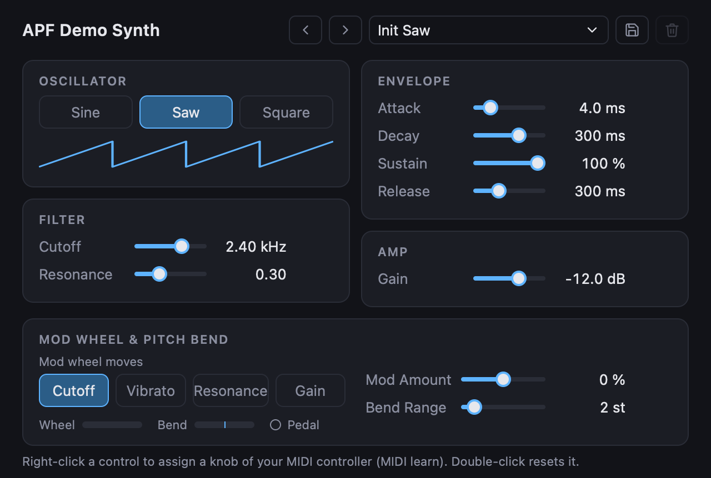

# APF - (Rust) Audio Plugin Framework

**Write multiplatform plugins using Rust, drawing the interface in HTML.**

APF is a framework for audio plugins: the instruments and effects you load into a music
program such as Logic Pro or REAPER. You write the sound in Rust. The plugin's window is a web
page. One crate becomes a plugin in every common format.

- **Formats:** CLAP, VST3, Audio Unit (v2 and v3) and a standalone app, built from the same code.
- **Web interface:** HTML, CSS and JavaScript in the system's web view. MIDI learn, presets,
  resizing and host automation need no extra code.
  The web view comes from [wry](https://github.com/tauri-apps/wry), the web-view library of
  the [Tauri](https://tauri.app) project (WebKit on macOS, WebView2 on Windows).
- **Real-time safe:** every example is tested under a counting allocator that fails if
  `process` allocates memory.
- **MIT:** the framework is MIT licensed and its dependencies are permissively licensed.



The demo synth in `examples/demo-synth`. Its window is an ordinary web page.

## A plugin

A gain control, complete. (`examples/02-gain` is the same plugin with smoothing, so the volume
does not click when you turn the knob.)

```rust
use apf::prelude::*;

const PARAMS: &[ParamDef] = &[ParamDef::float("gain", "Gain", -60.0, 12.0, 0.0).unit("dB")];
const GAIN: ParamId = ParamId::of(PARAMS, "gain");

struct Gain;

impl Plugin for Gain {
    const INFO: PluginInfo = PluginInfo {
        id: "com.example.gain", name: "Gain", vendor: "Example", url: "", version: "0.1.0",
        description: "A gain control", features: &["audio-effect", "stereo"],
    };
    const LAYOUT: AudioLayout = AudioLayout::EFFECT_STEREO;
    const PARAMS: &'static [ParamDef] = PARAMS;

    fn new() -> Self { Gain }

    fn process(&mut self, audio: &mut AudioBuffer, ctx: &ProcessContext) -> ProcessStatus {
        let gain = db_to_gain(ctx.params.get_f32(GAIN));
        for channel in audio.channels_mut() {
            for sample in channel { *sample *= gain; }
        }
        ProcessStatus::Continue
    }
}

apf::export_plugin!(Gain);
```

The editor is a page. This is all it takes to show the slider:

```html
<script src="/__apf/apf.js"></script>
<input type="range" data-param="gain">
```

## Quick start

You need [Rust](https://rustup.rs) and, on macOS, Xcode's command line tools and CMake
(Windows: Visual Studio 2022 Build Tools and CMake; see the book).

```sh
git clone https://github.com/mihasm/apf && cd apf
cargo test -p example-02-gain                    # plays audio through the plugin, in memory
cargo xtask bundle example-02-gain               # builds the plugin files into dist/release/
cargo xtask bundle example-02-gain --install     # also copies them where music programs look
cargo xtask new my-synth                         # starts a project of your own
```

The first build downloads clap-wrapper and the VST3 SDK (see [wrapper/](wrapper)), so it needs
a network connection. Then rescan plugins in your music program.

## Where to go next

The book in [docs/book](docs/book) teaches APF step by step, from installing to presets and
testing. Read it in a browser with [mdBook](https://rust-lang.github.io/mdBook/)
(`cargo install mdbook`, then `mdbook serve docs/book --open`), or open the Markdown files in
`docs/book/src`.

Ten small examples, each a complete plugin with a test that renders audio without a sound card:

| # | Example | Teaches |
|---|---|---|
| [01](examples/01-sine) | sine | the `Plugin` trait: a note in, a sine out |
| [02](examples/02-gain) | gain | an effect with a parameter |
| [03](examples/03-params) | params | every kind of parameter |
| [04](examples/04-envelope) | envelope | voices, envelopes, velocity |
| [05](examples/05-modulation) | modulation | LFO, mod wheel, pitch bend |
| [06](examples/06-filter) | filter | a filter and its cutoff |
| [07](examples/07-gui) | gui | the web editor, a level meter |
| [08](examples/08-presets-and-state) | presets-and-state | presets and plugin state |
| [09](examples/09-midi-and-learn) | midi-and-learn | sustain pedal, MIDI learn, automation |
| [10](examples/10-synth) | synth | a complete small synth that combines 04 to 09 |

## Status

APF is **pre-1.0**: it works, but its API may still change.

| | Formats | Checked in |
|---|---|---|
| macOS (Apple silicon) | CLAP, VST3, AUv2, AUv3, standalone | Logic Pro, REAPER |
| Windows (x64) | CLAP, VST3 | REAPER |

Not yet: Linux, LV2, AAX, the Windows standalone. Other hosts may work but are not
verified. Known problems are in [docs/known-issues.md](docs/known-issues.md), planned work in
[docs/todo.md](docs/todo.md), what changed in [CHANGELOG.md](CHANGELOG.md). Test results are in
the book's [Validation](docs/book/src/validation.md) chapter.

## Related projects

Other ways to build plugins; pick them if you need Linux, LV2, AAX or native widgets today.

- [nice-plug](https://codeberg.org/RustAudio/nice-plug): Rust, community successor of NIH-plug (egui, iced).
- [Beamer](https://github.com/helpermedia/beamer): Rust, MIT, built around a web interface; macOS first.
- [truce](https://github.com/truce-audio/truce): Rust, more formats including AAX and LV2, native GUIs.
- [coupler](https://github.com/coupler-rs/coupler): Rust, VST3 and CLAP.
- [JUCE](https://juce.com) 8 (web views) and [iPlug2](https://github.com/iPlug2/iPlug2): C++.

The book has an honest [comparison](docs/book/src/comparison.md).

## Licence

APF is MIT licensed ([LICENSE](LICENSE)). Everything a plugin built with it contains is
permissively licensed too; [docs/licences.md](docs/licences.md) lists each component.
